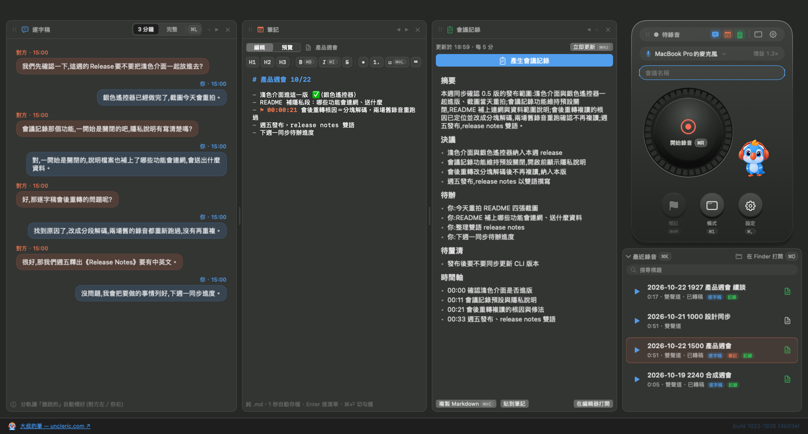

# 🦜 MyParrot

**Bot-free 的 macOS 會議錄音 + 逐字稿 app。** 把線上會議的雙方錄進同一個立體聲檔——**對方=左聲道、你=右聲道**,每句話天生就標好講者。不用 diarization 模型、不用機器人進會議、所有資料不離開你的 Mac。

[English README →](README.md)


<p>

</p>
<p>
 &nbsp;

</p>
<p>

</p>

## 0.5.1 新東西

- **修正:錄音中把麥克風切到藍牙耳機會整台卡住**:引擎重建原本在主執行緒跑(耳機進通話模式時一次約 6 秒),還會隨鏈路在 A2DP／HFP 之間切換而反覆重建。現在麥克風引擎都在背景佇列建立,新引擎先建好才停舊的(你軌空檔從約 6 秒縮到 0.1～0.3 秒),藍牙麥在使用期間維持通話模式讓格式不再跳動。麥克風藥丸會轉 5～6 秒「切換中…」,其餘操作不受影響。
- **修正:藍牙麥錄音中斷線,你軌會空白最長 20 秒**:現在約 1 秒內退回內建麥。
- **修正:Mac 沒聲音在播時跳假的「系統音訊已自動重新啟動」橫幅**:看門狗先確認輸出裝置有沒有在跑,閒置就不重建。
- 裝置清單刷新與對方軌 tap 的拆建也離開主執行緒;麥克風切換卡住會在 20 秒逾時收口,不再無限等。
- 已知:藍牙麥仍是雙向電話音質(HFP);內建麥錄音中藍牙耳機**重新連上**時,你軌可能空白約 8 秒(引擎自癒,下一版修);iPhone Continuity 麥切換需 1.5～2 秒。

## 0.5.0 新東西

- **全新介面（UI v2）**:Siri Remote 風格遙控器(淺色＝銀色鋁合金、深色＝黑曜石)＋面板工作區:逐字稿／筆記／會議記錄三欄可開關、拖曳換位、在視窗內互換欄寬;檔案面板加搜尋、sidecar 標記、重新命名與移到垃圾桶。
- **筆記**:每場一份 Markdown 筆記,⌘⇧M 標記時間,逐字稿一鍵引用進筆記。
- **會議記錄(選用、預設關)**:錄音中每 N 分鐘自動整理「摘要／決議／待辦／待釐清／時間軸」,結束後一鍵產生。後端可選 **Apple 本機模型**(macOS 26+,Apple Intelligence,資料不出機)或 **Claude CLI**(本機 `claude` 指令,逐字稿與筆記會送到 Anthropic,開啟前會先看到隱私說明)。
- **逐字稿校正(選用、預設關)**:找出最可能聽錯的詞提出建議,人決定才改;後端同上。接受過的校正在高精度重轉後會接回新稿。
- **修正:會後重轉整份複讀同一句**:整檔一次送 Whisper 時,長時間雙人對話會讓模型咬住一句幻覺、重複到檔尾(即時稿本身是好的)。檔案重轉改成跟即時逐字稿同一套語音活動切塊、每塊獨立解碼;即時稿另存 `.live.srt` 保留。
- **修正:錄音中藍牙耳機連上會整個 app 崩潰**:麥克風引擎重建踩到 AVFoundation 斷言直接 abort;現在改成重試與退回,不再把錄音連 app 一起殺掉。
- **會後重轉的時機**:改成「閒置時(接電、沒在錄音、兩分鐘沒碰鍵盤滑鼠)」才跑,也可選「立刻」或「不重轉」。Whisper 閒置 3 分鐘自動卸載。
- **外觀設定**:跟隨系統／淺色／深色。首次啟動會提示 AI 功能在哪裡開。
- **GUI 與 CLI 同時存在的防護(實驗)**:同一時間只有一個錄音 writer;啟動時不再把別的進程正在寫的錄音當壞檔收割;GUI 開著時看得到 CLI 的錄音並能停。
- 行事曆提醒錄音(預設關),以及多項錄音穩定性修正。
- **系統需求變更**:macOS 15 以上;SpeechAnalyzer 即時逐字稿與 Apple 本機模型需 macOS 26 以上。

## 0.3.1 新東西

- **全新 App 圖示與吉祥物**:現代軟萌風戴耳機鸚鵡(AI 生圖+人工迭代拍板);錄音中吉祥物**拍翅+張嘴唱歌**,系統開「減少動態效果」時自動靜止。
- **轉稿狀態跟著錄音列**:轉逐字稿/轉檔中的狀態直接顯示在對應的錄音列上(不再藏在逐字稿區頂端),轉稿中該列按鈕變轉圈。
- **逐字稿中文更準**:轉寫引導詞加入會議場景詞彙(錄音、逐字稿、會議記錄、摘要),「逐字稿」不再被聽成「竹子稿」這類同音錯字。
- 介面:footer 連結有底線與手型游標、build 版號可點直達本 GitHub;迷你模式電平表改用與主畫面一致的 dB 刻度;最近錄音列表顯示 20 筆;視窗最小寬度調整為狀態列不換行的 380pt。
- **CLI 安全修正(重要)**:hooks 佔位符(`{audio}` 等)展開時自帶 shell 引號——惡意檔名不再可能注入命令;**模板內不要再自行為佔位符加引號**。另修:hook 回報的 transcript 路徑正確透傳、選單 Ctrl-C 後終端不再殘留 raw mode、`hooks run transcribe` 套用產物驗證、timeout 拒絕非法值。

## 0.3.0 新東西

- **波形＋播放進度**:播放舊錄音時,列內直接畫出雙聲道波形(上=對方、下=你),一眼看出誰在哪段講話;點波形任一處就跳過去,▶⇄❚❚ 暫停續播、播完 ↻ 重播。波形算好會快取在本機,重開 app 秒出。
- **鍵盤快捷鍵**:⌘R 開始/⌘P 暫停/⌘E 結束/⌘N 新錄音/⌘T 轉逐字稿/⌘O Finder/⌘1 切換視窗模式/⌘L 逐字稿 3 分鐘·完整/⌘K 收折列表/⌘, 設定——**快捷鍵直接印在按鈕上**,不用背。
- **三種視窗模式一鍵輪巡**(⌘1):標準(記住你拉的大小)→ 窄版 320pt → 懸浮迷你列。
- **電平表改 dB 刻度**:一般語音亮一半以上、安靜時只剩一格,不再「明明在講話卻像沒收到音」。
- **`myparrot` 命令列工具**:給終端機使用者和 AI agent 用——`record / stop / status / transcribe / list / devices / config / hooks`,`--json` 事件流;**hooks** 可在錄音結束後自動把逐字稿交給任何命令(例如 Claude Code 做會議記錄)。見下方。
- **新版本提醒**:啟動時背景查一次 GitHub Releases,有新版只在主畫面放一條非阻斷提示(可在設定關閉;只打 `api.github.com`,不送任何資料)。
- 修正:停止錄音後立刻轉逐字稿不再失敗;同一分鐘同標題連錄兩段不再互相覆蓋;已轉稿的錄音按文件鈕直接打開逐字稿。

## 為什麼分軌?

會議逐字稿最難的是「誰說了什麼」。MyParrot 用物理繞過機器學習:對方走系統音訊 tap、你走麥克風,各佔一個聲道。拆軌、各自辨識、按時間交織——講者歸屬零錯誤,完全離線。

## 功能

- **對方聲音** — Core Audio **Process Tap**(macOS 14.4+):不裝驅動、不裝核心擴充、不建虛擬音訊裝置
- **你的聲音** — AVAudioEngine 麥克風擷取,**錄音中裝置/路由變更也不斷**(configuration-change 自癒 + 心跳看門狗;錄音中熱切換麥克風、檔案保持連續)
- **即時逐字稿** — 可切換引擎:macOS 26 **SpeechAnalyzer**(長時串流,macOS 15 自動 fallback SFSpeechRecognizer),或全離線的 **Whisper** 引擎(whisper.cpp + Metal,large-v3 系列)——中英夾雜辨識更準。停止後高精度 Whisper 重轉在機器閒置時才跑(也可選立刻／不重轉),即時稿另存 `.live.srt` 保留
- **筆記、會議記錄、逐字稿校正** — 每場一份 Markdown 筆記;選用的 AI 會議記錄與校正建議(預設關),後端可選 **Apple 本機模型** 或本機 **Claude CLI**,設定頁單一「模型」區段統一管理
- **外觀** — 跟隨系統／淺色／深色;Siri Remote 風格遙控器,淺色銀、深色黑曜石
- Whisper 模型可在 app 內下載(設定頁)或自己丟一顆 `ggml-*.bin` 進 Application Support——不內建、不打電話回家
- **舊錄音轉逐字稿** → `.txt` + 帶時間碼、講者前綴的 `.srt`,Whisper 輸出自動簡轉繁
- **離線回音消除**(選用、非破壞式——另存 `*_aec.m4a`,原檔永不被動)
- CAF→m4a 自動轉檔、錄音中防誤關、懸浮迷你模式、增益+軟限幅
- 介面:繁中/簡中/英/日/韓
- 主畫面右下 **build 標記**,永遠知道自己跑的是哪一版
- **隱私**:預設離線。會連網的只有「新版本提醒」(GitHub Releases,可關)、你自己按下的 Whisper 模型下載,以及**只在你開啟 Claude CLI 後端時**,會議記錄／校正會透過本機 `claude` 指令把逐字稿與筆記送到 Anthropic(開啟前有隱私說明)。Apple 本機模型後端資料不出機。行事曆提醒(預設關)需要行事曆與通知權限

## 需求

- **macOS 15+**——**建議 26.1+**:SpeechAnalyzer 即時逐字稿與 Apple 本機模型需 macOS 26+,且 26.0 有已知 process-tap regression;macOS 15 的即時逐字稿走 SFSpeechRecognizer 或本機 Whisper
- **Swift 6 工具鏈** — **Command Line Tools 就夠** build、跑、自測;只有 `swift test` 需要完整 Xcode
- **cmake**(`brew install cmake`)——一次性,只為了從原始碼建置本機 Whisper 引擎(見下方快速開始)

## 下載

上 **[Releases](https://github.com/tingyulu/MyParrot/releases/latest)** 抓最新簽章+公證版,解壓縮後把 `MyParrot.app` 拖進 `/Applications` 就能用,不需要任何建置工具,Gatekeeper 不會擋(Developer ID 簽章+公證過)。

想自己 build 原始碼?見下方。

## 自行建置

```bash
git clone <this-repo> && cd MyParrot
bash scripts/fetch-whisper.sh   # 一次性:從原始碼建置本機 Whisper 引擎(~5-10 分鐘,需 Xcode + cmake)
swift build                     # 編譯驗證
bash scripts/build-app.sh       # 組裝、簽章、裝到 ~/Applications
open ~/Applications/MyParrot.app
```

首次啟動會要 **麥克風**、**語音辨識**、**系統音訊擷取** 三個權限(**不會**要螢幕錄製);**行事曆**與**通知**只在你到設定開啟會議提醒時才會問。

## ⚠️ 常見坑(先讀,省你一小時)

1. **簽章與權限記憶。** macOS 的權限(TCC)綁簽章身份。`build-app.sh` 自動選最好的:Apple Development / Developer ID 憑證(有 Team ID → **重 build 權限不重問**)→ 自簽 → ad-hoc(**每次重 build 都重問**)。只要鑰匙圈裡有 Apple 憑證,腳本會自己找到。
2. **`.app` 別放 iCloud 同步目錄。** iCloud Drive 會反覆重貼 Finder xattr、弄壞簽章——所以腳本裝到 `~/Applications`。
3. **藍牙麥可以用,但雙向都是電話音質。** 任何 app 一開藍牙麥,整條藍牙鏈路就從 A2DP 掉到窄頻 HFP——**連對方的聲音都跟著變電話音質**。建議講話用內建/有線/USB 麥,耳機拿來聽(自動選麥已避開藍牙)。錄音中真要切到藍牙麥(0.5.1 起),藥丸會轉 5～6 秒「切換中…」等耳機進通話模式;耳機斷線會在約 1 秒內退回內建麥。
4. **clone 後第一次 `swift build` 就失敗?** 先跑 `bash scripts/fetch-whisper.sh`。Whisper 引擎的二進位(~35MB)沒進 git——這支腳本第一次會從原始碼建置(需要 Xcode + `cmake`)。

## `myparrot` 命令列工具(0.3.0 起)

```bash
bash scripts/build-cli.sh        # 建置+簽章,裝到 ~/bin/myparrot(Whisper 引擎借用 ~/Applications/MyParrot.app 的框架)
myparrot                          # 終端機直接打:互動選單(選麥克風、開錄、看電平)
myparrot record --name 產品週會 --max-duration 2h   # 前景錄音;Ctrl-C 或另開終端 myparrot stop
myparrot transcribe "~/Documents/MyParrot/2026-08-20 1400 產品週會.m4a"
myparrot list --json | jq .       # 給 agent/腳本:每行一個 JSON 事件,非 TTY 自動零 ANSI
```

**Hooks** — 設定檔 `~/.config/myparrot/config.json` 的 `hooks` 段,錄音結束後自動(或手動 `myparrot hooks run`)把逐字稿交給任意命令;佔位符 `{audio}` `{transcript}` `{name}` `{dir}`,完整 metadata 走 stdin JSON。第一次要 `myparrot hooks approve`(trust-on-first-use,改了設定要重核准)。0.3.1 起佔位符展開時自帶 shell 引號,**模板內不要再自行為佔位符加引號**。

```jsonc
{
  "hooks": {
    "minutes": {   // 逐字稿就緒後執行——讓 Claude Code 直接寫會議記錄
      "command": "claude -p \"讀 {transcript},用繁中寫一頁會議記錄,存成 {dir}/{name}.md\"",
      "cwd": "~/Documents/MyParrot",
      "auto": true
    }
  }
}
```

也可以用 `transcribe` hook **取代**內建轉錄(交給你自己的 ASR),失敗自動回退內建引擎;另一種範本是把「錄音已好」丟給既有的 AI session/待辦系統,由它接手後製。權限歸屬=你的終端機 app(第一次會問麥克風/系統音訊)。

## 已知限制

| 項目 | 現況 |
| --- | --- |
| 長會議(>30 分) | 兩個擷取時鐘緩慢漂移;取樣級同步規劃中 |
| 藍牙耳機當輸出+任一 app 佔用藍牙麥 | 電話音質天花板——HFP 協定限制,軟體救不了 |
| 錄音中切「到」藍牙麥 | 等耳機進通話模式 5～6 秒(藥丸顯示「切換中…」);切換瞬間一聲爆音;你軌空檔 <0.3 秒 |
| 內建麥錄音中藍牙耳機**重新連上** | 你軌可能空白約 8 秒(引擎自癒)——下一版修 |
| iPhone Continuity 麥 | 切換需 1.5～2 秒(裝置啟動時間) |
| <0.3 秒的短暫擷取中斷 | 不補零(換來零 click);該窗口內該軌可能前移 ≤0.3s |
| 回音消除 | 離線後製、預設關 |
| GUI 與 CLI 同時錄音 | 全域租約一次只允許一個 writer;目前用合成 writer 驗證,尚未在兩支真麥克風錄音下驗過 |
| 日文／韓文介面字串 | 機器輔助翻譯,尚未經母語者校對 |

## 法律

多數法域錄音需事先告知/取得同意。**使用者自行負責**遵守所在地法規。

## 架構

檔案地圖見 [英文版 README](README.md#architecture);測試金字塔與驗證方式見 [docs/TESTING.md](docs/TESTING.md)。

## 作者

大叔（Eric Lu）——30 年產品人，產品顧問・獵頭・職涯教練。每週好幾場線上面談，受不了裝 bot 進會議的彆扭，就自己寫了這支。

- 長文正本：[uncleric.com](https://www.uncleric.com)
- 日常出沒：[Threads @tingyulu](https://www.threads.com/@tingyulu)｜[LinkedIn](https://www.linkedin.com/in/uncleeric/)

## License

MIT © 2026 Eric Lu — 見 [LICENSE](LICENSE)。
