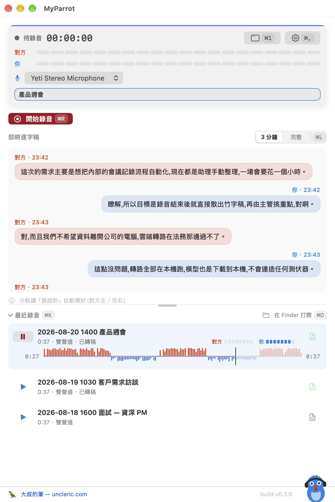
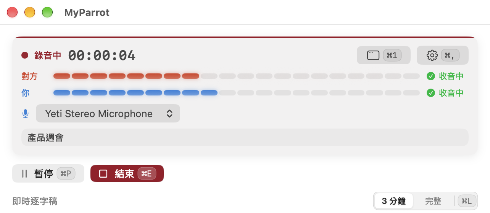
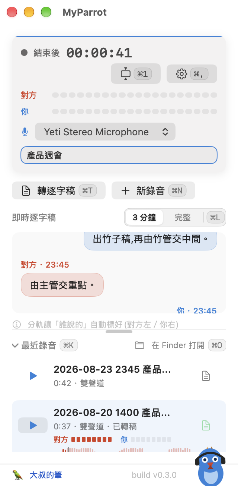
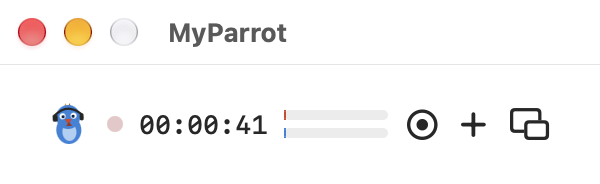

# 🦜 MyParrot

**Bot-free 的 macOS 會議錄音 + 逐字稿 app。** 把線上會議的雙方錄進同一個立體聲檔——**對方=左聲道、你=右聲道**,每句話天生就標好講者。不用 diarization 模型、不用機器人進會議、所有資料不離開你的 Mac。

[English README →](README.md)



<p>

</p>
<p>
 &nbsp;

</p>

## 0.3.0 新東西

- **波形＋播放進度**:播放舊錄音時,列內直接畫出雙聲道波形(上=對方、下=你),一眼看出誰在哪段講話;點波形任一處就跳過去,▶⇄❚❚ 暫停續播、播完 ↻ 重播。波形算好會快取在本機,重開 app 秒出。
- **鍵盤快捷鍵**:⌘R 開始/⌘P 暫停/⌘E 結束/⌘N 新錄音/⌘T 轉逐字稿/⌘O Finder/⌘1 切換視窗模式/⌘L 逐字稿 3 分鐘·完整/⌘K 收折列表/⌘, 設定——**快捷鍵直接印在按鈕上**,不用背。
- **三種視窗模式一鍵輪巡**(⌘1):標準(記住你拉的大小)→ 窄版 320pt → 懸浮迷你列。
- **電平表改 dB 刻度**:一般語音亮一半以上、安靜時只剩一格,不再「明明在講話卻像沒收到音」。
- **`myparrot` 命令列工具**:給終端機使用者和 AI agent 用——`record / stop / status / transcribe / list / devices / config / hooks`,`--json` 事件流;**hooks** 可在錄音結束後自動把逐字稿交給任何命令(例如 Claude Code 做會議記錄)。見下方。
- **新版本提醒**:啟動時背景查一次 GitHub Releases,有新版只在主畫面放一條非阻斷提示(可在設定關閉;只打 `api.github.com`,不送任何資料)。
- 修正:停止錄音後立刻轉逐字稿不再失敗;同一分鐘同標題連錄兩段不再互相覆蓋;已轉稿的錄音按文件鈕直接打開逐字稿。

## 為什麼分軌?

會議逐字稿最難的是「誰說了什麼」。MyParrot 用物理繞過機器學習:對方走系統音訊 tap、你走麥克風,各佔一個聲道。拆軌、各自辨識、按時間交織——講者歸屬零錯誤,完全離線。

## 功能

- **對方聲音** — Core Audio **Process Tap**(macOS 14.4+):不裝驅動、不裝核心擴充、不建虛擬音訊裝置
- **你的聲音** — AVAudioEngine 麥克風擷取,**錄音中裝置/路由變更也不斷**(configuration-change 自癒 + 心跳看門狗;錄音中熱切換麥克風、檔案保持連續)
- **即時逐字稿** — 三選一引擎:macOS 26 **SpeechAnalyzer**(長時串流,舊系統自動 fallback SFSpeechRecognizer),或全離線的 **Whisper** 引擎(whisper.cpp + Metal,large-v3 系列)——中英夾雜辨識更準;錄音中即時轉完,停止後自動升級成高精度重轉一次
- Whisper 模型可在 app 內下載(設定頁)或自己丟一顆 `ggml-*.bin` 進 Application Support——不內建、不打電話回家
- **舊錄音轉逐字稿** → `.txt` + 帶時間碼、講者前綴的 `.srt`,Whisper 輸出自動簡轉繁
- **離線回音消除**(選用、非破壞式——另存 `*_aec.m4a`,原檔永不被動)
- CAF→m4a 自動轉檔、錄音中防誤關、懸浮迷你模式、增益+軟限幅
- 介面:繁中/簡中/英/日/韓
- 主畫面右下 **build 標記**,永遠知道自己跑的是哪一版
- **隱私**:全程離線。唯一會連網的是「新版本提醒」(GitHub Releases,可關)與你自己按下的 Whisper 模型下載

## 需求

- **macOS 14.4+**(系統音訊 Process Tap)——**建議 26.1+**(即時逐字稿;26.0 有已知 process-tap regression)
- **Swift 6 工具鏈** — **Command Line Tools 就夠** build、跑、自測;只有 `swift test` 需要完整 Xcode
- **cmake**(`brew install cmake`)——一次性,只為了從原始碼建置本機 Whisper 引擎(見下方快速開始)

## 下載

上 **[Releases](https://github.com/tingyulu/MyParrot/releases/latest)** 抓最新簽章+公證版,解壓縮後把 `MyParrot.app` 拖進 `/Applications` 就能用,不需要任何建置工具,Gatekeeper 不會擋(Developer ID 簽章+公證過)。

想自己 build 原始碼?見下方。

## 自行建置

```bash
git clone <this-repo> && cd MyParrot
bash scripts/fetch-whisper.sh   # 一次性:從原始碼建置本機 Whisper 引擎(~5-10 分鐘,需 Xcode + cmake)
swift build                     # 編譯驗證
bash scripts/build-app.sh       # 組裝、簽章、裝到 ~/Applications
open ~/Applications/MyParrot.app
```

首次啟動會要 **麥克風**、**語音辨識**、**系統音訊擷取** 三個權限(**不會**要螢幕錄製)。

## ⚠️ 常見坑(先讀,省你一小時)

1. **簽章與權限記憶。** macOS 的權限(TCC)綁簽章身份。`build-app.sh` 自動選最好的:Apple Development / Developer ID 憑證(有 Team ID → **重 build 權限不重問**)→ 自簽 → ad-hoc(**每次重 build 都重問**)。只要鑰匙圈裡有 Apple 憑證,腳本會自己找到。
2. **`.app` 別放 iCloud 同步目錄。** iCloud Drive 會反覆重貼 Finder xattr、弄壞簽章——所以腳本裝到 `~/Applications`。
3. **麥克風別用藍牙耳機。** 任何 app 一開藍牙麥,整條藍牙鏈路就從 A2DP 掉到窄頻 HFP——**連對方的聲音都跟著變電話音質**。耳機拿來聽,講話用內建/有線/USB 麥。(自動選麥已避開藍牙;手動選仍可,但會警告。)
4. **clone 後第一次 `swift build` 就失敗?** 先跑 `bash scripts/fetch-whisper.sh`。Whisper 引擎的二進位(~35MB)沒進 git——這支腳本第一次會從原始碼建置(需要 Xcode + `cmake`)。

## `myparrot` 命令列工具(0.3.0 起)

```bash
bash scripts/build-cli.sh        # 建置+簽章,裝到 ~/bin/myparrot(Whisper 引擎借用 ~/Applications/MyParrot.app 的框架)
myparrot                          # 終端機直接打:互動選單(選麥克風、開錄、看電平)
myparrot record --name 產品週會 --max-duration 2h   # 前景錄音;Ctrl-C 或另開終端 myparrot stop
myparrot transcribe "~/Documents/MyParrot/2026-08-20 1400 產品週會.m4a"
myparrot list --json | jq .       # 給 agent/腳本:每行一個 JSON 事件,非 TTY 自動零 ANSI
```

**Hooks** — 設定檔 `~/.config/myparrot/config.json` 的 `hooks` 段,錄音結束後自動(或手動 `myparrot hooks run`)把逐字稿交給任意命令;佔位符 `{audio}` `{transcript}` `{name}` `{dir}`,完整 metadata 走 stdin JSON。第一次要 `myparrot hooks approve`(trust-on-first-use,改了設定要重核准)。

```jsonc
{
  "hooks": {
    "minutes": {   // 逐字稿就緒後執行——讓 Claude Code 直接寫會議記錄
      "command": "claude -p \"讀 {transcript},用繁中寫一頁會議記錄,存成 {dir}/{name}.md\"",
      "cwd": "~/Documents/MyParrot",
      "auto": true
    }
  }
}
```

也可以用 `transcribe` hook **取代**內建轉錄(交給你自己的 ASR),失敗自動回退內建引擎;另一種範本是把「錄音已好」丟給既有的 AI session/待辦系統,由它接手後製。權限歸屬=你的終端機 app(第一次會問麥克風/系統音訊)。

## 已知限制

| 項目 | 現況 |
| --- | --- |
| 長會議(>30 分) | 兩個擷取時鐘緩慢漂移;取樣級同步規劃中 |
| 藍牙耳機當輸出+任一 app 佔用藍牙麥 | 電話音質天花板——HFP 協定限制,軟體救不了 |
| 錄音中切「到」藍牙麥 | 切換瞬間一聲爆音(OS profile 切換) |
| <0.3 秒的短暫擷取中斷 | 不補零(換來零 click);該窗口內該軌可能前移 ≤0.3s |
| 回音消除 | 離線後製、預設關 |

## 法律

多數法域錄音需事先告知/取得同意。**使用者自行負責**遵守所在地法規。

## 架構

檔案地圖見 [英文版 README](README.md#architecture);測試金字塔與驗證方式見 [docs/TESTING.md](docs/TESTING.md)。

## 作者

大叔（Eric Lu）——30 年產品人，產品顧問・獵頭・職涯教練。每週好幾場線上面談，受不了裝 bot 進會議的彆扭，就自己寫了這支。

- 長文正本：[uncleric.com](https://www.uncleric.com)
- 日常出沒：[Threads @tingyulu](https://www.threads.com/@tingyulu)｜[LinkedIn](https://www.linkedin.com/in/uncleeric/)

## License

MIT © 2026 Eric Lu — 見 [LICENSE](LICENSE)。
